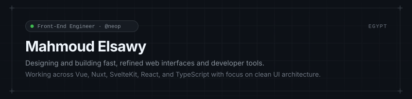
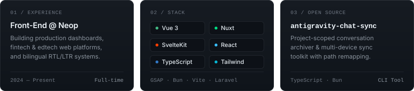

<picture>
  <source media="(prefers-color-scheme: dark)" srcset="./assets/hero-dark.svg" />
  <source media="(prefers-color-scheme: light)" srcset="./assets/hero-light.svg" />
  
</picture>

  <samp>
    <a href="https://github.com/neop-planet">neop</a> &nbsp;·&nbsp;
    <a href="https://github.com/MahmoudELsawy0357/antigravity-chat-sync">antigravity-chat-sync</a> &nbsp;·&nbsp;
    <a href="https://github.com/MahmoudELsawy0357?tab=repositories">repositories</a> &nbsp;·&nbsp;
    <a href="mailto:mahmoud@neop.sa">mahmoud@neop.sa</a>
  </samp>

<picture>
  <source media="(prefers-color-scheme: dark)" srcset="./assets/bento-dark.svg" />
  <source media="(prefers-color-scheme: light)" srcset="./assets/bento-light.svg" />
  
</picture>
