<!-- Animated Custom Hero Banner -->

 

<!-- Animated Typing Headline -->

 

<!-- Quick Connect & Status Badges -->

  
  
  
  

---

### ⚡ About Me

<table>
  <tr>
    <td width="58%" valign="top">
      

        I'm <b>Mahmoud Elsawy</b>, a <b>Front-End Developer</b> focused on building sleek, responsive, and high-performance web applications with pixel-level attention to detail and smooth UI motion.
      

      <ul>
        <li>🏢 Currently engineering production web dashboards &amp; platforms at <a href="https://github.com/neop-planet"><b>@neop-planet</b></a> using <b>Vue 3, Nuxt, TypeScript &amp; Tailwind CSS</b>.</li>
        <li>🛠️ Building open-source developer &amp; CLI tooling with <b>TypeScript &amp; Bun</b> (check out <a href="https://github.com/MahmoudELsawy0357/antigravity-chat-sync"><code>antigravity-chat-sync</code></a>).</li>
        <li>🎨 Passionate about modern reactive ecosystems (<b>SvelteKit, React, GSAP</b>), design systems, and clean component architecture.</li>
        <li>📫 Reach me directly at <a href="mailto:mahmoud@neop.sa"><b>mahmoud@neop.sa</b></a>.</li>
      </ul>
    </td>
    <td width="42%" valign="top">
      <h4 align="center">🎯 Engineering Focus</h4>
      <ul>
        <li><b>Architecture:</b> Modular, type-safe component systems</li>
        <li><b>Performance:</b> Core Web Vitals, SSR &amp; lazy hydration</li>
        <li><b>UI &amp; Motion:</b> GSAP, micro-interactions &amp; RTL/LTR layouts</li>
        <li><b>DX &amp; Automation:</b> CLI tools, CI/CD &amp; workflow automation</li>
      </ul>
    </td>
  </tr>
</table>

---

### 🛠️ Tech Stack &amp; Tools

#### Frontend &amp; UI Engineering

  

#### Runtime, Backend &amp; Developer Workflow

  

---

### 🚀 Featured Work &amp; Highlights

<table>
  <tr>
    <td width="50%" valign="top">
      <h4>💬 <a href="https://github.com/MahmoudELsawy0357/antigravity-chat-sync">antigravity-chat-sync</a></h4>
      

        <b>Open-Source CLI &amp; Sync Toolkit</b> — Project-scoped Google Antigravity conversation archiver and multi-device sync engine with smart additive merging, cross-drive workspace remapping, and automatic Markdown transcript splitting.
      

      

        <code>TypeScript</code> <code>Bun</code> <code>CLI</code> <code>Developer Tools</code>
      

    </td>
    <td width="50%" valign="top">
      <h4>🏢 Enterprise Dashboards &amp; Web Platforms</h4>
      

        <b>Production Systems @ Neop</b> — End-to-end front-end engineering for FinTech, EdTech, and enterprise control panels, featuring role-based views, bilingual RTL/LTR interfaces, and REST API integrations.
      

      

        <code>Vue 3</code> <code>Nuxt</code> <code>TypeScript</code> <code>Tailwind CSS</code>
      

    </td>
  </tr>
</table>

---

### 📊 GitHub Analytics &amp; Streak

  
  &nbsp;
  

---

### 🐍 Contribution Graph

  <picture>
    <source media="(prefers-color-scheme: dark)" srcset="https://raw.githubusercontent.com/MahmoudELsawy0357/MahmoudELsawy0357/output/dist/github-snake-dark.svg" />
    <source media="(prefers-color-scheme: light)" srcset="https://raw.githubusercontent.com/MahmoudELsawy0357/MahmoudELsawy0357/output/dist/github-snake.svg" />
    
  </picture>

 

  

